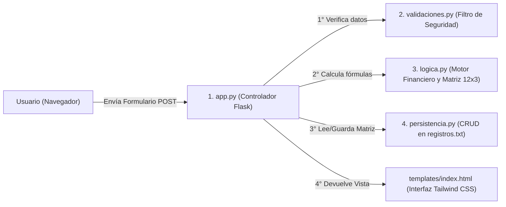

# Informe Técnico de Estudio, Complejidad y Preparación para Defensa: Proyecto AhorraMás

> [!IMPORTANT]
> **Resumen de la Optimización Realizada:**
> Todo el proyecto fue reescrito bajo el **Paradigma de Programación Estructurada y Modular (0% Programación Orientada a Objetos / 0 Clases)**. Se eliminaron todas las clases (`class`) que existían en `arboles.py`, `colas_enlazadas.py`, `grafos.py`, `listas.py` y `archivo.py`, reemplazándolas por **estructuras de datos nativas (diccionarios y listas/matrices)** manipuladas por funciones puras. Además, se eliminó la duplicación de código en `app.py`, `logica.py`, `validaciones.py` y `persistencia.py`, y se corrigieron etiquetas HTML mal cerradas en `templates/index.html`.

---

## 1. Arquitectura General del Proyecto (Cómo explicarlo en 30 segundos)

Si el profesor te pide que expliques cómo está organizado el proyecto, usa este esquema mental de **4 capas + estructuras de datos**:



1. **[app.py](file:///c:/Users/huasc/Documents/Ahorra%20mas/proyecto_optimizado_comentado/app.py) (El Director de Orquesta / Controlador):** No calcula ni valida nada por sí mismo; recibe lo que el usuario envía desde la web, llama a `validaciones.py`, luego a `logica.py` o `persistencia.py`, y devuelve la pantalla con `renderizar_panel()`.
2. **[validaciones.py](file:///c:/Users/huasc/Documents/Ahorra%20mas/proyecto_optimizado_comentado/validaciones.py) (El Escudo / Sanitización):** Limpia espacios, convierte textos con comas o puntos a números decimales (`float`), impide números negativos o iguales a cero donde habría división por cero, y verifica que las fechas límite sean estrictamente futuras.
3. **[logica.py](file:///c:/Users/huasc/Documents/Ahorra%20mas/proyecto_optimizado_comentado/logica.py) (El Cerebro Matemático):** Contiene las reglas financieras (semáforo 70%/90%, reglas de ahorro 60/25/15 y 70/20/10, matriz anual de 12x3 y cálculo de metas definidas e indefinidas).
4. **[persistencia.py](file:///c:/Users/huasc/Documents/Ahorra%20mas/proyecto_optimizado_comentado/persistencia.py) (La Memoria en Disco):** Maneja el CRUD (Crear, Leer, Actualizar y Eliminar) guardando una **matriz bidimensional** `[fila][columna]` dentro de un archivo de texto plano (`registros.txt`) separado por `||`.
5. **Módulos de Estructuras de Datos Estructuradas (Sin Clases):**
   - [listas.py](file:///c:/Users/huasc/Documents/Ahorra%20mas/proyecto_optimizado_comentado/listas.py): Manejo de listas dinámicas en memoria y ordenamiento Timsort.
   - [colas_enlazadas.py](file:///c:/Users/huasc/Documents/Ahorra%20mas/proyecto_optimizado_comentado/colas_enlazadas.py): Cola FIFO con nodos basados en diccionarios `{"dato": x, "siguiente": None}`.
   - [arboles.py](file:///c:/Users/huasc/Documents/Ahorra%20mas/proyecto_optimizado_comentado/arboles.py): Árbol N-ario jerárquico de categorías financieras usando recursividad.
   - [grafos.py](file:///c:/Users/huasc/Documents/Ahorra%20mas/proyecto_optimizado_comentado/grafos.py): Grafo no dirigido con listas de adyacencia y recorridos BFS y DFS.
   - [archivo.py](file:///c:/Users/huasc/Documents/Ahorra%20mas/proyecto_optimizado_comentado/archivo.py): Gestión procedimental de archivos de registros y bitácora histórica (`operaciones.txt`).

---

## 2. ¿Cuáles son las partes MÁS COMPLEJAS del código? (Dónde debes poner más atención)

Aquí están los **6 puntos críticos** del código donde los profesores suelen enfocar la lupa técnica:

### Complejidad #1: La Matriz Bidimensional en dos lugares distintos (`logica.py` y `persistencia.py`)
El proyecto usa el concepto de **Matriz (lista de listas)** en dos contextos que no debes confundir:
- **Matriz Temporal `[12 x 3]` en `calcular_ahorro_anual` ([logica.py](file:///c:/Users/huasc/Documents/Ahorra%20mas/proyecto_optimizado_comentado/logica.py#L120-L129)):**
  Es una matriz en memoria RAM de 12 filas (meses 1 al 12) y 3 columnas: `[mes, cuota_fija, total_acumulado]`. Se genera con un ciclo `for mes in range(1, 13):`.
- **Matriz Persistente `[N x 5]` en `cargar_matriz_registros` ([persistencia.py](file:///c:/Users/huasc/Documents/Ahorra%20mas/proyecto_optimizado_comentado/persistencia.py#L17-L28)):**
  Es una matriz de $N$ filas (según cuántos registros haya en `registros.txt`) y 5 columnas fijas:
  - Columna `[0]`: ID del registro (`"1"`, `"2"`, etc.)
  - Columna `[1]`: Nombre del titular
  - Columna `[2]`: Tipo de operación
  - Columna `[3]`: Monto formateado a 2 decimales
  - Columna `[4]`: Fecha y hora (`YYYY-MM-DD HH:MM:SS`)

### Complejidad #2: Aritmética Modular para Calcular Meses Futuros (`calcular_fecha_futura` en [logica.py](file:///c:/Users/huasc/Documents/Ahorra%20mas/proyecto_optimizado_comentado/logica.py#L199-L207))
```python
total_meses = (fecha_base.month - 1) + meses
nuevo_ano = fecha_base.year + (total_meses // 12)
nuevo_mes = total_meses % 12
```
- **¿Por qué es compleja?** Porque los meses van del 1 al 12, pero los índices de una lista en Python van del 0 al 11.
- **Cómo funciona:** Restamos `1` al mes actual (`fecha_base.month - 1`) para llevarlo a base cero (Enero = 0, Diciembre = 11), le sumamos los `meses` que tardará en ahorrar, y luego:
  - La división entera `// 12` nos dice **cuántos años completos** hay que sumar al año actual.
  - El residuo o módulo `% 12` nos da **el índice exacto (0 a 11)** del nuevo mes en la lista `meses_nombres`.

### Complejidad #3: Generación del ID Autoincremental sin Base de Datos (`crear_registro` en [persistencia.py](file:///c:/Users/huasc/Documents/Ahorra%20mas/proyecto_optimizado_comentado/persistencia.py#L72-L75))
```python
ids_validos = [int(fila[0]) for fila in matriz if fila[0].isdigit()]
nuevo_id = max(ids_validos) + 1 if ids_validos else 1
```
- **¿Por qué no usamos `len(matriz) + 1`?** ¡Pregunta clásica de examen! Si tienes los registros con ID `1, 2, 3` y borras el `2`, quedan `1` y `3` (`len(matriz)` es 2). Si usaras `len(matriz) + 1`, el nuevo registro tendría ID `3` y **habría dos registros con ID #3 repetido**. En cambio, con `max(ids_validos) + 1`, toma el mayor (`3`) y suma 1 (`4`), evitando colisiones de IDs.

### Complejidad #4: Conversión Tolerante a Fallos de Números (`convertir_a_flotante` en [validaciones.py](file:///c:/Users/huasc/Documents/Ahorra%20mas/proyecto_optimizado_comentado/validaciones.py#L28-L41))
- **¿Por qué es compleja?** Porque un usuario puede escribir `"25,000.50"` (coma de miles y punto decimal) o `"25000,50"` (coma decimal estilo europeo/latino).
- **Cómo lo resuelve:**
  1. Si tiene **ambos** (`,` y `.`), elimina la coma porque asume que es separador de miles.
  2. Si **solo tiene coma** (`,`), la reemplaza por punto (`.`) para que `float()` de Python lo entienda.
  3. Usa `try / except ValueError` para que nunca se caiga el servidor si alguien escribe letras.

### Complejidad #5: Punteros con Diccionarios en la Cola Enlazada (`encolar` y `desencolar` en [colas_enlazadas.py](file:///c:/Users/huasc/Documents/Ahorra%20mas/proyecto_optimizado_comentado/colas_enlazadas.py#L61-L97))
- **¿Cómo se hace una lista/cola enlazada sin clases (`class Nodo`)?**
  En Python, un diccionario se pasa por referencia igual que un objeto. Cada nodo es `{"dato": valor, "siguiente": None}`. Cuando hacemos `cola["final"]["siguiente"] = nuevo_nodo`, la llave `"siguiente"` del último diccionario apunta directamente en memoria al nuevo diccionario, logrando inserción y extracción en tiempo constante `O(1)`.

### Complejidad #6: Recursividad en Árboles y Grafos (`buscar_nodo` en [arboles.py](file:///c:/Users/huasc/Documents/Ahorra%20mas/proyecto_optimizado_comentado/arboles.py#L46-L58) y `recorrido_profundidad_dfs` en [grafos.py](file:///c:/Users/huasc/Documents/Ahorra%20mas/proyecto_optimizado_comentado/grafos.py#L121-L135))
- **Diferencia clave entre ambos:** En un árbol no hay ciclos cerrados (un hijo nunca apunta a su abuelo), por lo que `buscar_nodo` se llama a sí misma sobre cada `hijo` sin necesitar lista de visitados. En cambio, en un **grafo** sí puede haber ciclos (A conectado con B, B con C y C con A), por lo que `recorrido_profundidad_dfs` utiliza un conjunto `visitados = set()` para no quedarse atrapado en un bucle infinito.

---

## 3. Panorama de Preguntas que Puede Hacer el Profesor (Clasificadas por Categoría)

1. **Sobre el Paradigma (Por qué sin POO):**
   - *¿Por qué decidieron no usar clases y cómo organizaron el código para que no fuera un desorden?*
   - *¿Cómo representaron estructuras dinámicas (árboles, colas enlazadas, grafos) sin usar `class`?*
2. **Sobre las Estructuras de Datos (Matrices):**
   - *¿Dónde están las matrices en su proyecto y qué dimensiones tienen?*
   - *¿Cómo se accede a un elemento específico de la matriz en Python y en la plantilla HTML Jinja2?*
3. **Sobre la Persistencia y Archivos:**
   - *¿Por qué usaron `||` como separador en `registros.txt` en lugar de una coma `,`?*
   - *¿Qué pasa internamente en `persistencia.py` cuando se actualiza o elimina un registro?*
4. **Sobre la Lógica Financiera y Matemática:**
   - *¿Por qué en `calcular_meta_indefinida` usan `math.ceil()` y no `round()`?*
   - *¿De dónde sale el número `30.41` en `calcular_meta_definida`?*
5. **Sobre Ingeniería Web (Flask):**
   - *¿Por qué algunas rutas terminan en `render_template` y las del CRUD terminan en `redirect(url_for(...))`?*
   - *¿Cómo sabe el archivo `index.html` qué pestaña debe mostrar después de enviar un formulario?*

*(En el documento [SIMULACRO_PROFESOR_DEFENSA.md](file:///c:/Users/huasc/Documents/Ahorra%20mas/SIMULACRO_PROFESOR_DEFENSA.md) tienes cada una de estas preguntas respondidas palabra por palabra junto con la intención del profesor).*

---

## 4. Método de Estudio Paso a Paso Antes de Defender el Proyecto

No intentes memorizar el código línea por línea. Los profesores detectan de inmediato cuando alguien memorizó sin entender. Usa el **Método de Trazabilidad en 4 Fases (Te tomará ~2 horas dominar todo el proyecto):**

### Fase 1: El Mapa de 4 Archivos Principales (25 minutos)
Abre la carpeta [proyecto_optimizado_comentado](file:///c:/Users/huasc/Documents/Ahorra%20mas/proyecto_optimizado_comentado) y lee los archivos **en este orden exacto** (no empieces por `app.py`):
1. Primero lee **[validaciones.py](file:///c:/Users/huasc/Documents/Ahorra%20mas/proyecto_optimizado_comentado/validaciones.py)**: Entiende cómo entra un texto sucio del formulario y sale una tupla `(es_valido, datos, errores)`.
2. Segundo lee **[logica.py](file:///c:/Users/huasc/Documents/Ahorra%20mas/proyecto_optimizado_comentado/logica.py)**: Mira cómo cada función recibe números ya limpios, aplica una fórmula matemática sencilla y devuelve un diccionario `{...}` con los resultados redondeados a 2 decimales.
3. Tercero lee **[persistencia.py](file:///c:/Users/huasc/Documents/Ahorra%20mas/proyecto_optimizado_comentado/persistencia.py)**: Observa cómo `cargar_matriz_registros()` convierte el archivo `registros.txt` en una lista de listas usando `.split("||")` y cómo `guardar_matriz_registros()` hace el proceso inverso con `"||".join(...)`.
4. Cuarto lee **[app.py](file:///c:/Users/huasc/Documents/Ahorra%20mas/proyecto_optimizado_comentado/app.py)**: Verás que todas las rutas tienen exactamente la misma estructura de 3 pasos:
   - Paso 1: Llamar a `validaciones`.
   - Paso 2: Si hay error, devolver `renderizar_panel(..., errores=errores)`.
   - Paso 3: Si es válido, llamar a `logica` o `persistencia` y devolver el resultado.

### Fase 2: Técnica "Sigue el Dato" (30 minutos)
Toma una hoja de papel y sigue el viaje de un solo dato (por ejemplo, cuando un usuario calcula su **Ahorro Anual** con capital `20000` y gastos `6000`):
1. En [index.html](file:///c:/Users/huasc/Documents/Ahorra%20mas/proyecto_optimizado_comentado/templates/index.html), el formulario hace `POST` a `/ahorro-anual`.
2. En [app.py](file:///c:/Users/huasc/Documents/Ahorra%20mas/proyecto_optimizado_comentado/app.py), `calcular_ahorro_anual()` recibe `request.form`.
3. Pasa por `validaciones.validar_datos_ahorro_anual(request.form)`, que reutiliza `validar_datos_gastos`.
4. Llega a `logica.calcular_ahorro_anual()`, la cual reutiliza `calcular_ahorro_mensual()`, detecta que gasta el 30% (`<= 60%`), asigna la regla `60/25/15` con cuota fija de `5000.0`, y con un bucle `for mes in range(1, 13)` arma la matriz de 12 filas `[mes, 5000.0, acumulado]`.
5. Regresa a `index.html`, donde `` dibuja las 12 filas de la tabla usando `fila[0]`, `fila[1]` y `fila[2]`.

> [!TIP]
> Si puedes explicar ese recorrido de 5 pasos con tus propias palabras, **ya dominas el 80% de la defensa**.

### Fase 3: Técnica Feynman con las Dos Carpetas (35 minutos)
1. Lee una función en [proyecto_optimizado_comentado](file:///c:/Users/huasc/Documents/Ahorra%20mas/proyecto_optimizado_comentado) (donde están los bloques **QUÉ HACE / POR QUÉ LO HACE / PARA QUÉ SIRVE**).
2. Luego abre el mismo archivo en [proyecto_optimizado_sin_comentarios](file:///c:/Users/huasc/Documents/Ahorra%20mas/proyecto_optimizado_sin_comentarios) y **explícale en voz alta a la pantalla qué hace cada función mirando solo el código limpio**.
3. Si en alguna función dudas, vuelve a mirar el comentario en la carpeta comentada.

### Fase 4: Práctica de Modificación en Vivo (30 minutos)
A muchos profesores les gusta pedir un cambio pequeño en vivo durante la defensa para comprobar que tú hiciste o entiendes el código. Practica estos 3 micro-retos:
- **Reto 1:** *"Cambia la proyección anual de 12 meses a 24 meses."* -> Vas a [logica.py](file:///c:/Users/huasc/Documents/Ahorra%20mas/proyecto_optimizado_comentado/logica.py#L126) en `calcular_ahorro_anual` y cambias `range(1, 13)` por `range(1, 25)`.
- **Reto 2:** *"Cambia el límite de la alerta financiera en Meta Definida del 50% al 60%."* -> Vas a [logica.py](file:///c:/Users/huasc/Documents/Ahorra%20mas/proyecto_optimizado_comentado/logica.py#L160) en `calcular_meta_definida` y cambias `0.50` por `0.60`.
- **Reto 3:** *"Agrega una validación para que el nombre tenga al menos 3 letras."* -> Vas a [validaciones.py](file:///c:/Users/huasc/Documents/Ahorra%20mas/proyecto_optimizado_comentado/validaciones.py#L94) y cambias `if not nombre:` por `if len(nombre) < 3:`.
